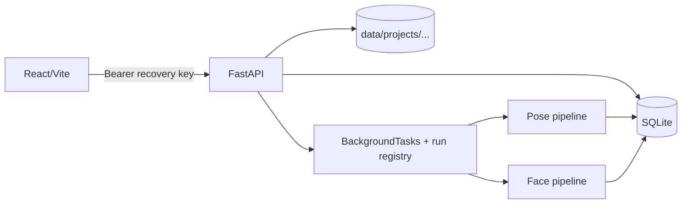

# Landmark QA — AI Project Guide

> Mục đích: giúp AI/developer hiểu và sửa dự án mà không phải đọc toàn bộ source.  
> Phạm vi kiểm chứng: source backend, frontend, config, test và tài liệu trong repository tại thời điểm viết.  
> Nguồn sự thật cuối cùng khi có xung đột: **test → source → YAML config → tài liệu này → tài liệu lịch sử**.

## 1. Dự án làm gì?

Landmark QA là ứng dụng web kiểm định nhãn keypoint do con người gán bằng cách so với dự đoán AI và các luật hình học. Dự án có hai feature độc lập:

| Feature | Schema | Mô hình | Kết quả chính |
|---|---|---|---|
| Human Pose | `vf_humanpose17_v1` | YOLO26s-pose, RTMPose-m, tùy chọn YOLOv8m-pose | danh sách warning theo từng keypoint |
| Face Landmark | `vf_face_landmark50_v1` | MediaPipe Face Landmarker 478 điểm, ánh xạ về VF50 | kết quả theo từng face/frame, 14 luật, NME và review từng điểm |

Nguyên tắc thiết kế quan trọng:

- Pose và Face không import logic nghiệp vụ của nhau; chỉ dùng chung core, database, upload ZIP và job dispatcher.
- Annotation nguồn được giữ nguyên. Review không ghi đè annotation; file cleaned chỉ được dựng khi export.
- Mọi tài nguyên thuộc project được bảo vệ bằng recovery key.
- Backend và frontend dùng chung cho cả hai feature; đây không phải hai ứng dụng riêng.

## 2. Bản đồ repository

```text
backend/
├── app/main.py                         # composition root FastAPI
├── app/core/                           # config, SQLite, auth
├── app/shared/                         # ZIP/image metadata, job registry
├── app/routers/                        # project/dataset/run/Pose warning API
├── app/features/human_pose/            # nghiệp vụ Pose hiện hành
├── app/features/face_landmark_vf50/    # nghiệp vụ Face hiện hành
├── configs/schemas/                    # định nghĩa 17 và 50 điểm
├── configs/face_landmark_vf50/         # ngưỡng Face, nguồn sự thật cấu hình
├── scripts/                            # model download, EXIF, so sánh dữ liệu
└── tests/                              # contract và regression tests

frontend/src/
├── app/App.tsx                         # route /, /pose, /face
├── features/human-pose/HumanPosePage.tsx
└── features/face-landmark-vf50/        # page, types, edges/groups

experiments/model_check/                # benchmark nghiên cứu; không thuộc runtime
docs/                                   # tài liệu dành cho người/AI
```

Các file `backend/app/adapters/*` và `backend/app/services/*` chỉ là compatibility re-export. Code mới phải dùng namespace `app.features...`.

## 3. Kiến trúc runtime và luồng chung



Luồng đầy đủ:

1. `POST /api/projects` tạo project và trả recovery key đúng một lần.
2. Client upload ZIP ảnh, schema và annotation tới endpoint dataset.
3. Backend giải nén an toàn, chuẩn hóa annotation, ghi `datasets/images/annotations`.
4. `POST /runs?dataset_id=...` chọn mode từ schema:
   - Pose → `K2` ban đầu.
   - Face → `face_mediapipe_vf50`.
5. FastAPI `BackgroundTasks` gọi registry trong `shared/jobs/runner.py`.
6. Pipeline ghi warning Pose hoặc `face_frame_results`.
7. UI tải kết quả, review, rồi export dữ liệu đã làm sạch.

Lưu ý: job chạy trong process web, không có Celery/Redis và không bền qua restart.

## 4. Chạy và kiểm thử

Yêu cầu: Python 3.10+, Node/npm. Backend dùng FastAPI, SQLite, Ultralytics, RTMLib/ONNXRuntime, OpenCV, MediaPipe, SciPy.

```powershell
cd backend
python -m venv .venv
.\.venv\Scripts\Activate.ps1
pip install -r requirements.txt
python scripts/download_face_landmarker.py
uvicorn app.main:app --reload --port 8000
```

Model Face mặc định: `backend/models/face_landmarker.task`. Có thể override bằng `FACE_LANDMARKER_MODEL_PATH`.

```powershell
cd frontend
npm install
npm run dev -- --port 5173
```

- Trang chủ: `http://localhost:5173/`
- Pose: `/pose`
- Face: `/face`
- OpenAPI: `http://localhost:8000/docs`

Kiểm tra trước khi bàn giao:

```powershell
cd backend
python -m unittest discover -s tests -v

cd ..\frontend
npm run build
```

Biến môi trường:

| Biến | Mặc định | Ý nghĩa |
|---|---|---|
| `LANDMARK_DATA_DIR` | `backend/data` | database, dataset, backup |
| `CORS_ORIGINS` | `http://localhost:5173` | danh sách origin, phân tách bởi dấu phẩy |
| `QA_ENSEMBLE_MODE` | `K2` | `K1`, `K2`, `K3` cho Pose |
| `FACE_LANDMARKER_MODEL_PATH` | `backend/models/face_landmarker.task` | model MediaPipe `.task` |

## 5. Data contract chung

### 5.1 Trạng thái điểm

Mỗi điểm có `{id, name, x, y, state}`:

- `visible`: có tọa độ số.
- `occluded`: vẫn phải có tọa độ ước lượng.
- `outside`: `x = y = null`.

### 5.2 `landmark-qa/v1`

```json
{
  "format": "landmark-qa/v1",
  "schema_id": "vf_humanpose17_v1",
  "images": [{
    "file_name": "folder/frame.jpg",
    "width": 1280,
    "height": 720,
    "annotations": [{
      "label": "person",
      "keypoints": [{"id": 1, "name": "nose", "x": 100, "y": 80, "state": "visible"}]
    }]
  }]
}
```

Pose nhận COCO Keypoints JSON hoặc `landmark-qa/v1`; bắt buộc có annotation. Face nhận CVAT XML, COCO JSON, `landmark-qa/v1`, cleaned JSON, hoặc ZIP chỉ có ảnh. Parser chủ động từ chối schema Pose tải nhầm vào Face và ngược lại.

COCO visibility được đổi như sau: `v=0 → outside`, `v=1 → occluded`, `v=2 → visible`.

### 5.3 Upload ZIP

- Tối đa 500 MiB, tối đa 10.000 entry.
- Chỉ nhận `.jpg/.jpeg/.png/.webp`.
- Shared extractor chặn path traversal, symlink, duplicate path và giới hạn tổng dung lượng giải nén.
- Tên file annotation được ghép theo relative path trước, rồi basename duy nhất.
- EXIF orientation được kiểm tra để tọa độ và pixel không lệch hệ quy chiếu.

## 6. Human Pose — schema và triển khai

### 6.1 VF17

ID: `1 nose`; cặp phải/trái lần lượt là `(2,3) eye`, `(4,5) ear`, `(6,7) shoulder`, `(8,9) elbow`, `(10,11) wrist`, `(12,13) hip`, `(14,15) knee`, `(16,17) ankle`.

Quy ước VinFast đặt **right ở ID chẵn, left ở ID lẻ**. Adapter phải đổi COCO (left trước right) qua `COCO_TO_VF17`; bỏ bước này sẽ tạo swap giả hàng loạt.

### 6.2 Mode model

| Mode | Model mục tiêu | Hành vi lỗi |
|---|---|---|
| `K1` | YOLO26s | nhanh, một model |
| `K2` | YOLO26s + RTMPose-m | mặc định |
| `K3` | K2 + YOLOv8m-pose | YOLOv8m lỗi thì tiếp tục với model còn lại |
| `K1_fallback` | YOLO26s | RTMPose khởi tạo lỗi |

YOLO26s là bắt buộc. Prediction cache trong RAM dùng khóa `(absolute image path, model name, mtime)`.

### 6.3 Pipeline Pose chính xác

1. Đọc tất cả annotation của dataset.
2. Chạy từng predictor tuần tự.
3. Với mỗi model, ghép người dự đoán có tâm bbox/keypoint gần tâm annotation nhất.
4. Chọn YOLO26s làm bbox tham chiếu; loại model phụ nếu `IoU < 0.30`.
5. Dùng bbox tham chiếu để tính scale người.
6. Với từng điểm human không phải `outside`, hợp nhất dự đoán model thành `p*`.
7. Tính disagreement, OKS suspicion, reliability và ranking score.
8. Kiểm tra swap trái/phải.
9. Điểm `occluded` không swap được đổi thành `hard_case` và giảm score 50%.
10. Chỉ lưu warning khi `score >= 0.20`, rồi sắp giảm dần.

### 6.4 Công thức Pose

Ký hiệu quan sát model cho keypoint `i`: `(p_{k,i}, c_{k,i}, w_k)` gồm tọa độ, confidence và trọng số model.

Trọng số hiện hành:

```text
w(YOLO26s)   = 2026.5
w(RTMPose-m) = 2854.5
w(YOLOv8m)   = 1827.1
```

Vị trí đồng thuận:

$$
p_i^*=\frac{\sum_k w_kc_{k,i}p_{k,i}}{\sum_k w_kc_{k,i}}
$$

Nếu tổng `w*c` bằng 0, code dùng trung bình theo `w`; nếu cả `w` cũng không hợp lệ, lấy quan sát đầu.

Scale người từ bbox `(x1,y1,x2,y2)`:

$$
s=\sqrt{\max(10,x_2-x_1)\max(10,y_2-y_1)}
$$

Nếu không có bbox: `s = 0.3 * sqrt(image_width * image_height)`.

Độ bất đồng model:

$$
\delta_i=\frac{1}{s}\sqrt{\frac{\sum_k w_kc_{k,i}\lVert p_{k,i}-p_i^*\rVert^2}{\sum_k w_kc_{k,i}}}
$$

Sai số human so với đồng thuận: `d_i = ||h_i - p_i*||`. Suspicion kiểu OKS:

$$
e_i=1-\exp\left[-\frac{(d_i/s)^2}{2((2\sigma_i)^2+\lambda\delta_i^2)}\right],\quad \lambda=0.5
$$

`σ_i` theo COCO sau khi map sang VF17: nose .026, eye .025, ear .035, shoulder .079, elbow .072, wrist .062, hip .107, knee .087, ankle .089.

Confidence hợp nhất trong source là trung bình theo **trọng số model**, không nhân confidence vào mẫu trọng số:

$$
\bar c_i=\frac{\sum_k w_kc_{k,i}}{\sum_k w_k}
$$

Phạt thiếu model và reliability:

$$
\rho=\min(1,\max(0.1,K_{eff}/K_{target}))
$$

$$
R_i=\operatorname{clip}_{[0,1]}\left(\rho\bar c_i\exp[-\delta_i^2/(2\tau^2)]\right),\quad \tau=0.08
$$

Điểm xếp hạng cuối:

$$
Score_i=\operatorname{clip}_{[0,1]}(e_iR_i^\alpha),\quad \alpha=0.5
$$

### 6.5 Phát hiện swap

Với hai điểm đối xứng `i,j`:

```text
orig = ||h_i-p*_i|| + ||h_j-p*_j||
swap = ||h_i-p*_j|| + ||h_j-p*_i||
```

Gắn `swap_error` nếu đồng thời:

```text
swap < 0.6 * orig
orig > 0.15 * s
```

Khi đó `Score >= 0.88`.

### 6.6 Kết quả/review Pose

Mỗi warning lưu human point, suggested point `p*`, `suspicion`, `reliability`, `delta`, loại warning và `annotation_id`. Review là `human` hoặc `model`. Export thay tọa độ nguồn bằng suggested point chỉ cho warning chọn model; các warning chưa review hoặc chọn human giữ nguyên.

### 6.7 Cảnh báo implementation Pose

`execute_run()` hiện bắt mọi exception rồi gọi `make_mock_results()`. Nghĩa là lỗi model/runtime có thể tạo warning giả deterministic và đánh run `completed`, không phải `failed`. Đây là hành vi hiện tại nhưng nguy hiểm cho production; AI không được hiểu mock là kết quả inference thật.

## 7. Face VF50 — schema và ánh xạ model

### 7.1 Bảy skeleton

| Nhóm | ID | Số điểm | Kín |
|---|---:|---:|---|
| `longmaytrai` | 0–4 | 5 | không |
| `longmayphai` | 5–9 | 5 | không |
| `songmui` | 10–13 | 4 | không |
| `mattrai` | 14–21 | 8 | có |
| `matphai` | 22–29 | 8 | có |
| `moingoai` | 30–41 | 12 | có |
| `moitrong` | 42–49 | 8 | có |

Trái/phải theo **khung nhìn ảnh**, không theo cơ thể người trong ảnh.

12 anchor: `{0,4,5,9,10,13,14,18,22,26,30,36}`.

### 7.2 MediaPipe 478 → VF50

Detector chạy `IMAGE`, tối đa 5 face, ba ngưỡng confidence đều `0.3`. Mỗi face trả 478 tọa độ normalized; code đổi sang pixel rồi resample từng contour theo chiều dài cung.

Với polyline `P0...Pm`:

$$
\Delta s_k=\lVert P_{k+1}-P_k\rVert_2,\quad S_k=\sum_{j<k}\Delta s_j,\quad L=S_m
$$

Tại fraction `f`, đặt `d=fL`, tìm đoạn `S_k <= d <= S_{k+1}` và nội suy:

$$
t=\frac{d-S_k}{S_{k+1}-S_k},\quad P^*(f)=P_k+t(P_{k+1}-P_k)
$$

Các index MediaPipe nguồn nằm trong `adapters/mapper.py`. Fraction runtime đáng chú ý:

- Lông mày trái: `[0,.15,.41,.73,1]`; phải: `[0,.26,.58,.85,1]`.
- Sống mũi: `[0,.34,.67,1]`.
- Nửa trên mắt: `[0,.25,.5,.75,1]`; nửa dưới lấy `[.25,.5,.75]`.
- Môi ngoài trên: 7 điểm cách `1/6`; dưới: 5 điểm nội bộ.
- Môi trong trên: 5 điểm cách `1/4`; dưới: 3 điểm nội bộ.

### 7.3 Ghép nhiều mặt

- Trường hợp 1 annotation–1 detection có fast path.
- Nhiều mặt dùng Hungarian (`scipy.optimize.linear_sum_assignment`) trên ma trận khoảng cách centroid.
- Cặp chỉ được nhận nếu khoảng cách `<= 2 * IOD_detection`; fallback 150 px nếu IOD không đủ tin cậy.
- Annotation/detection không ghép vẫn sinh result riêng. Detection không annotation có `result_kind=unlabeled_face` và NME `null`.
- Legacy annotation tách thành 7 row chỉ được merge khi các tập point hợp lệ rời nhau; source row không bị sửa.

## 8. Face — IOD, quality và công thức

### 8.1 IOD cố định theo run

IOD được tính một lần khi tạo result và lưu cùng `iod_source`; review sau đó không đổi mẫu số. Chuỗi ưu tiên:

1. Khoảng cách hai tâm mắt từ model; mỗi mắt cần ít nhất 4 điểm, khoảng cách > 10 px.
2. Tương tự từ human.
3. Khoảng cách điểm 14–26 nhân `0.65`, model trước human.
4. `max(12, face_width * 0.42)` từ bbox keypoint, model trước human, cần ≥8 điểm.
5. Mặc định 96 px.

$$
IOD=\lVert C_{eye-left}-C_{eye-right}\rVert_2
$$

Trong chuẩn hóa sai số, mẫu số thực là `max(IOD, 10)`.

### 8.2 Sai số từng điểm và NME

Với human `h_i`, model `m_i`:

$$
e_i=\frac{\lVert h_i-m_i\rVert_2}{\max(IOD,10)}
$$

Tolerance:

- anchor: `T_i = 0.03`;
- contour: `T_i = 0.05`.

Severity điểm:

```text
e_i <= T_i         → NORMAL
T_i < e_i <= 1.8T_i → WARNING
e_i > 1.8T_i       → CRITICAL
```

Suspicion Face:

$$
S_i=\min(1,e_i/(2.5T_i))
$$

Nếu human state là `occluded`, `S_i := 0.6*S_i`.

NME chỉ lấy các cặp human/model có tọa độ hợp lệ:

$$
NME=\frac{1}{N}\sum_{i=1}^{N}e_i
$$

Pass khi `NME <= 0.035`. Nếu `N=0`, `nme`, `nme_pct`, `passed_nme` đều `null`, không được diễn giải là pass.

Face-level metrics còn có `e_max`, percentile `e_p90`, `exceed_count`, `has_outlier_point` (có ít nhất một CRITICAL).

### 8.3 Phân loại ca khó

- `face_scale`: CLOSE nếu `IOD>=80`, NORMAL nếu `IOD>=38`, ngược lại FAR.
- `sunglasses`: ≥4/16 điểm mắt là occluded/outside → AI reliability `.45`.
- `occluded`: nếu không sunglasses và ≥6 điểm toàn mặt bị che/outside → `.58`.
- `far`: nếu không hai loại trên và `IOD<35` → `.65`.
- còn lại `normal` → `.95`.

`ai_reliability` Face hiện là metadata hiển thị; nó không được nhân vào NME hay suspicion.

## 9. Face — 14 luật đúng theo source hiện tại

Đây là bảng canonical. Không dùng bảng R01–R14 trong `backend/tailieu/face_vf50/02_...` vì mã luật ở đó đã lệch phiên bản.

Đặt hệ số scale:

$$
q=\operatorname{clip}(IOD/96,0.25,2.5)
$$

| Mã | Luật runtime | Level | Điều kiện chính |
|---|---|---|---|
| R01 | Đầy đủ cấu trúc | ERROR | thiếu bất kỳ ID 0–49 |
| R02 | Quên sửa trạng thái | WARNING | đủ 50 điểm và cả 50 đều visible/không có state |
| R03 | Đảo trái–phải | ERROR | centroid-x mày trái ≥ phải hoặc mắt trái ≥ phải |
| R04 | Thứ tự x lông mày | ERROR | trong ≥8 điểm mày, `x_next < x_current - max(1.5,5q)` |
| R05 | Khóe mắt cực trị | ERROR | đủ 8 điểm/mắt nhưng min/max-x không ở 14/18 hoặc 22/26 |
| R06 | Mí trên thấp hơn mí dưới | ERROR | sau bù góc đầu, `y_top > y_bottom + max(.8,2q)` |
| R07 | Contour mắt tự cắt | ERROR | đa giác 8 điểm của một mắt tự giao |
| R08 | Sống mũi chia không đều | WARNING | ba đoạn đều >1 px và `max/min > 1.55` |
| R09 | Môi trong ngoài môi ngoài | ERROR | sai thứ tự corner-x hoặc điểm inner lip ngoài polygon quá tolerance |
| R10 | Ngưỡng ẩn skeleton | WARNING | mắt còn 1–3 visible hoặc mày còn 1–2 visible nhưng chưa outside cả nhóm |
| R11 | Điểm ngoài biên ảnh | ERROR | non-outside mà `x/y` ngoài `[0,width]×[0,height]` |
| R12 | Trùng tọa độ bất thường | WARNING | hai visible point cách `< max(.4,.012*IOD)`, trừ cặp mí/môi cho phép |
| R13 | Nhảy frame liền kề | WARNING | dịch chuyển `> max(5,15q)` px |
| R14 | Occluded lệch model | WARNING | human occluded cách model `> .15*IOD` |

Chi tiết hình học:

- R06 tính góc đầu `θ = atan2(Δy_eye_centers, Δx_eye_centers)` rồi xoay điểm quanh tâm hai mắt với `-θ` trước khi so y.
- R07 dùng kiểm tra giao của mọi cặp cạnh không kề bằng hướng CCW.
- R09 trước hết kiểm tra `x42 >= x30-tol` và `x46 <= x36+tol`; sau đó ray-casting point-in-polygon và khoảng cách tới cạnh polygon.
- R12 cho phép trùng các cặp mí `(15,21),(16,20),(17,19),(23,29),(24,28),(25,27)` và môi `(43,49),(44,48),(45,47)`.
- R13 chỉ chạy khi `frame_index` thật sự tồn tại và hai frame chênh đúng 1; face frame trước được chọn theo centroid gần nhất trong `1.5*IOD`.

Ghi chú cấu hình: YAML khai báo thêm threshold R10 cho môi/mũi nhưng vòng lặp runtime R10 hiện chỉ kiểm tra hai mắt và hai lông mày. YAML cũng có key `contour_tolerance_multiplier`, trong khi code R09 đọc `per_point_tolerance_px`; vì key sau không tồn tại nên runtime fallback `2.0*q` px. Đây là technical debt cần giữ ý thức khi chỉnh config.

## 10. Review và tính lại Face

Mỗi điểm review lưu nguồn `human|model` trong `face_point_reviews`, unique theo `(result_id, point_id)`. Không có row nghĩa là mặc định human nếu có, nếu không thì model.

Khi đổi nguồn điểm:

1. Dựng `reviewed_points` từ nguồn từng điểm.
2. Chạy lại 14 rules trên reviewed points.
3. Tính lại quality so với model.
4. **Tái sử dụng IOD đã lưu**, không tính IOD mới.
5. Cập nhật JSON quality/violations, severity và timestamp.

Status result: `pending`, `reviewed`, `fixed`.

Batch fix có hai bước bắt buộc: preview rồi apply với `confirm=true`; có thể giới hạn `only_violated` và `min_nme`.

Export Face:

- cleaned JSON (`landmark-qa/v1`),
- CVAT XML,
- CSV report,
- checklist.

## 11. API tóm tắt

Mọi endpoint project-scoped cần:

```http
Authorization: Bearer <recovery-key>
```

Ảnh có thể dùng `?token=<recovery-key>` vì thẻ `` khó gắn header. Recovery key chỉ lưu SHA-256; mất key không khôi phục được.

| Method | Path | Chức năng |
|---|---|---|
| POST | `/api/projects` | tạo project/key |
| GET | `/api/projects/{pid}` | project + datasets |
| POST | `/api/projects/{pid}/datasets` | upload multipart ZIP/schema/annotation |
| GET | `/api/projects/{pid}/datasets/{did}/images/{path}` | đọc ảnh |
| GET/POST | `/api/projects/{pid}/runs` | list/tạo run |
| GET | `/api/projects/{pid}/runs/{rid}` | progress/status/error |
| GET | `/api/projects/{pid}/runs/{rid}/warnings` | Pose warnings |
| POST | `/api/projects/{pid}/warnings/{wid}/review` | Pose review |
| GET | `/api/projects/{pid}/runs/{rid}/export` | Pose cleaned export |
| GET | `/api/projects/{pid}/runs/{rid}/face/results` | Face list/filter/sort/page |
| GET | `.../face/results/{result_id}` | Face detail |
| PUT | `.../face/results/{result_id}/points/{0..49}` | chọn human/model |
| PUT | `.../face/results/{result_id}/status` | đổi trạng thái |
| POST | `.../face/batch-preview` | xem tác động batch |
| POST | `.../face/batch-apply` | áp dụng batch có confirm |
| GET | `.../face/export/{cleaned-json|cvat-xml|csv|checklist}` | export Face |

## 12. Database

SQLite: `LANDMARK_DATA_DIR/landmark_qa.sqlite3`. Kết nối bật `foreign_keys`, row factory và commit theo context manager.

Quan hệ logic:

```text
projects
  └─ datasets
      └─ images
          └─ annotations       # nhãn nguồn bất biến
  └─ runs
      ├─ warnings              # Pose
      └─ face_frame_results    # Face
          └─ face_point_reviews
```

Các bảng Face lưu snapshot human/model, IOD + source, NME nullable, quality/violations JSON, aggregate count/severity, result kind, case metadata và review status.

Migration nhẹ chạy lúc startup, có bảng `schema_migrations`. Trước migration Face lần đầu mỗi version, database hiện có được backup vào `data/backups`. Không chỉnh tay schema mà bỏ qua `init_db()` và test migration.

## 13. Frontend

- React + TypeScript + Vite, `react-router-dom`.
- `HomePage` chọn feature; `/pose` và `/face` là hai page riêng.
- Mỗi page tự quản session/project/recovery key và gọi API trực tiếp.
- Pose UI: upload, start/poll run, lọc warning, overlay human/model, review, export.
- Face UI: mở run cũ, lọc rule, sort severity/frame/NME, overlay 7 skeleton, chọn nguồn từng điểm, status, batch preview/apply, JSON/XML export.
- Base API trong source frontend là `/api` theo host backend được cấu hình trong page/Vite; khi đổi topology deploy phải kiểm tra cả CORS và URL frontend.

## 14. Tests và vùng ảnh hưởng khi sửa

| Sửa phần | Test cần ưu tiên |
|---|---|
| ZIP/security | `test_safe_zip.py` |
| import/schema/EXIF/export Pose | `test_dataset_validation.py`, `test_pose_export_and_exif.py` |
| công thức ensemble | `test_ensemble.py` |
| boundary Pose–Face | `test_feature_boundaries.py` |
| DB migration | `test_face_migration.py` |
| API/review/export Face | `test_face_api.py` |
| parser CVAT/COCO | `face_vf50/test_cvat_parser.py` |
| mapper 478→50 | `face_vf50/test_mapper.py` |
| 14 rules/quality | `face_vf50/test_rules.py`, `test_enhancements.py` |
| YAML/spec | `face_vf50/test_spec.py` |

## 15. Technical debt và sự thật dễ hiểu sai

1. **Tài liệu rule cũ lệch source.** Dùng bảng ở mục 9.
2. **Ngưỡng Face chưa benchmark đầy đủ.** Chính YAML ghi rõ các threshold chưa hiệu chỉnh thực nghiệm; R08 runtime là 1.55, không phải 1.45.
3. **Pose có fallback mock khi runtime lỗi.** Không dùng output mock để đánh giá chất lượng model production.
4. **`POST /runs` luôn tạo Pose mode K2.** `QA_ENSEMBLE_MODE` chỉ được đọc sâu trong scoring; run row sau đó cập nhật actual mode.
5. **Face detector confidence chưa được lưu thực.** `detector_confidence` đang ghi `NULL` vì adapter không trả score.
6. **Face `ai_reliability` không tham gia công thức quality.** Chỉ là metadata.
7. **R10 config và runtime chưa đồng bộ**, R09 có tên key config/code lệch như ghi ở mục 9.
8. **Background job không bền.** Restart server có thể để run ở `pending/running`.
9. **NME không phải luật R13 runtime.** NME là quality metric riêng; R13 runtime là temporal jump.
10. **Unlabeled face có NME `null`.** Không chuyển thành 0 hay pass.

## 16. Quy tắc cho AI khi sửa dự án

- Đọc file này trước, sau đó chỉ mở source thuộc vùng thay đổi.
- Không thêm import chéo giữa `human_pose` và `face_landmark_vf50`.
- Không sửa annotation nguồn; thêm decision/review và dựng export.
- Mọi threshold Face mới nên vào `vf50_spec.yaml`, rồi đồng bộ key với code và test.
- Khi thêm schema/run mode: đăng ký handler trong `main.py`, cập nhật route chọn mode, migration nếu cần và frontend.
- Giữ đúng hệ tọa độ pixel và state semantics; đặc biệt `outside → null`.
- Giữ IOD Face bất biến trong vòng đời result review.
- Sau thay đổi công thức, cập nhật cả test và mục công thức tương ứng trong tài liệu này.
- Không tin số benchmark trong tài liệu lịch sử nếu chưa chạy lại `experiments/model_check` trên dataset được chỉ rõ.

## 17. Điểm vào source theo tác vụ

| Muốn làm gì | Bắt đầu từ |
|---|---|
| đổi upload/format | `routers/datasets.py`, hai service `dataset.py`/`ingestion.py` |
| đổi công thức Pose | `human_pose/services/ensemble.py`, `scoring.py` |
| thêm model Pose | `human_pose/adapters/`, `setup_predictors()` |
| đổi map Face 478→50 | `face_landmark_vf50/adapters/mapper.py` |
| đổi IOD/hình học | `face_landmark_vf50/rules/geometry.py` |
| đổi 14 rules | `rules/validation.py` + YAML + tests |
| đổi NME/suspicion/case | `scoring/quality.py` + YAML + tests |
| đổi matching/run Face | `services/run.py` |
| đổi review/export Face | `api.py`, `exporters/` |
| đổi DB | `core/database.py` + migration tests |
| đổi UI Pose/Face | page tương ứng dưới `frontend/src/features/` |

