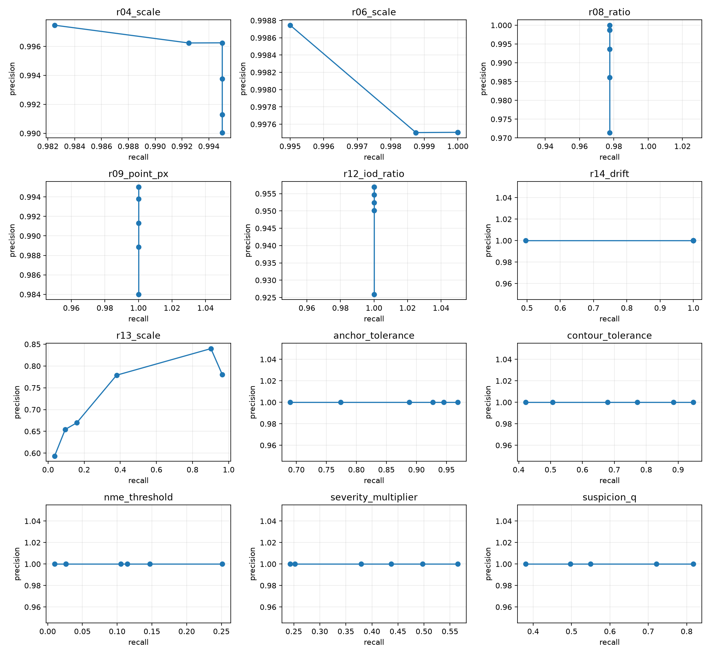
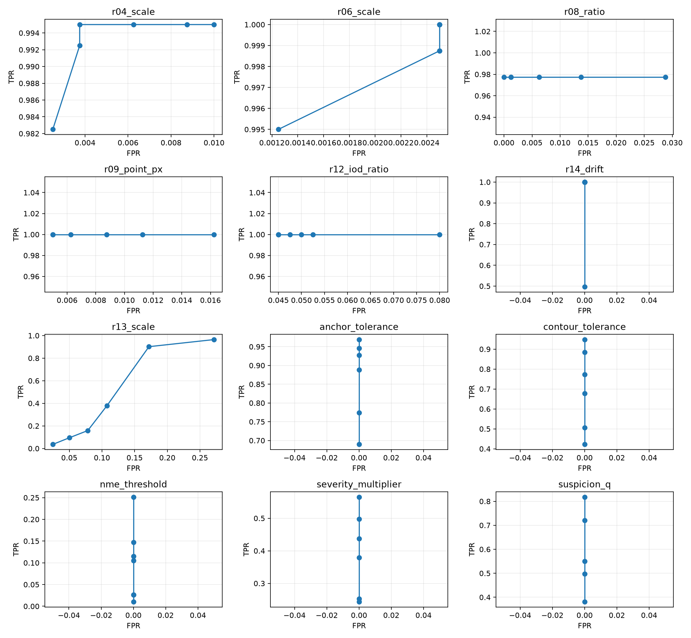

# Benchmark Face VF50 — Pha 3: chọn ngưỡng

## Thiết kế chống rò rỉ

Seed 42. Ngưỡng được chọn duy nhất trên 800 mặt DEV (500 WFLW + 300 300W); sau khi khóa mới đánh giá trên 800 mặt TEST độc lập. Tiêu chí định trước: F1 DEV lớn nhất, hòa thì FPR thấp hơn, tiếp theo là gần giá trị hiện tại hơn. R13 dùng 1.495 cặp DEV từ video `001,114,203,410,411` và 1.495 cặp TEST từ `124,125,208,211,516`. Toàn bộ grid và confusion count nằm tại `.bench_workspace/results/face_phase3_20261013/phase3_threshold_results.json`.





## So sánh TEST: luật hình học

| Tham số | Hiện tại → DEV chọn | F1 TEST trước → sau | FPR TEST trước → sau | Quyết định |
|---|---:|---:|---:|---|
| R04 multiplier | 5 → 5 | 0,9944 → 0,9944 | 0,25% → 0,25% | Giữ |
| R06 multiplier | 2 → 2 | 0,9994 → 0,9994 | 0,13% → 0,13% | Giữ |
| R08 max ratio | 1,55 → 2,5 | 0,9850 → 0,9905 | 1,25% → 0,13% | Chưa đề xuất: lỗi tiêm R08 chỉ có một mức hình học mạnh |
| R09 point tolerance | mặc định runtime 2 → 3 px·scale | 0,9926 → 0,9932 | 1,50% → 1,38% | Không áp dụng: key YAML hiện không điều khiển đoạn code này |
| R12 IOD ratio | 0,012 → **0,006** | 0,9610 → **0,9668** | 8,13% → **6,88%** | Đề xuất thử nghiệm |
| R13 multiplier | 15 → 15 | 0,9637 → 0,9637 | 3,95% → 3,95% | Giữ |
| R14 drift ratio | 0,15 → 0,15 | 1,000 → 1,000 | 0% → 0% | Giữ; dữ liệu state vẫn là tổng hợp |

Raw bảng: `.bench_workspace/results/face_phase3_20261013/test_comparison.csv`. R12=0,006 giảm vùng “trùng tọa độ” và giảm false-positive mà vẫn giữ recall 1,0 trên injection TEST. Đây vẫn chỉ là đề xuất thử nghiệm vì lỗi thật của người gán chưa có.

## Scoring: kết quả quét nhưng không đề xuất áp dụng

DEV chọn anchor 0,015; contour 0,02; NME 0,015; severity 1,2T; suspicion `q=1,5`. Trên TEST tổng hợp các giá trị này tăng F1, nhưng clean GT được dùng đúng bằng model reference nên toàn bộ clean error bằng 0 và FPR luôn 0. Bài toán vì thế thiên lệch về ngưỡng nhỏ nhất. Không có cơ sở trung thực để thay các giá trị production 0,03 / 0,05 / 0,035 / 1,8T / 2,5.

Các candidate vẫn được lưu trong raw và YAML để tái lập, nhưng nằm dưới `dev_selected_candidates_not_recommended`, không phải đề xuất production.

## Lệch config–code

- **R09:** YAML khai báo `contour_tolerance_multiplier`, nhưng runtime đọc `per_point_tolerance_px`. Khi đổi multiplier YAML từ 0,1 lên 100, số cảnh báo trên 100 mặt vẫn là 3→3: không thay đổi. Vì thế không thể hiệu chỉnh R09 bằng key hiện có.
- **R10:** YAML có ngưỡng cho mắt, mày, môi ngoài, môi trong và sống mũi; runtime chỉ lặp qua hai mắt và hai mày. Với 100 mẫu tiêm trạng thái thiếu một phần môi ngoài, R10 bắt 0/100. Coverage cho ba skeleton còn lại bằng 0 theo implementation hiện tại.

Raw audit: `.bench_workspace/results/face_phase3_20261013/config_code_audit.json`. Hai điểm này chỉ được báo cáo; không sửa code production.

## Đề xuất

File [proposed_vf50_thresholds.yaml](../experiments/benchmark_face/proposed_vf50_thresholds.yaml) chỉ đề xuất thử nghiệm `r12_coincident_points.iod_ratio_multiplier: 0.006`. Các ngưỡng khác giữ nguyên. Không tự áp dụng vào `vf50_spec.yaml`.

## Giới hạn

- Injection tổng hợp không đại diện đầy đủ lỗi người thật; R08/R14 đặc biệt thiếu nhiều mức severity.
- Model reference lý tưởng làm quét scoring không đủ sức đo trade-off precision–recall ngoài đời.
- WFLW/300W thiếu visibility thật; chưa thể hiệu chỉnh R02/R10/R14 đáng tin cậy.
- R13 biến thiên mạnh theo video/category; tập con chỉ gồm 10 video.
- Kết quả TEST chỉ đánh giá một lần theo lựa chọn DEV, nhưng cùng họ dữ liệu public nên vẫn có domain gap với dữ liệu mục tiêu.

## Tái lập

```powershell
backend/.venv/Scripts/python.exe experiments/benchmark_face/bench_phase3_thresholds.py --output .bench_workspace/results/face_phase3_20261013 --zip-300vw .bench_workspace/datasets/300vw/300VW_Dataset_2015_12_14.zip --limit 500 --seed 42
backend/.venv/Scripts/python.exe experiments/benchmark_face/bench_summarize_phase3.py .bench_workspace/results/face_phase3_20261013
backend/.venv/Scripts/python.exe experiments/benchmark_face/bench_phase3_config_code_audit.py .bench_workspace/results/face_phase3_20261013/config_code_audit.json
```
